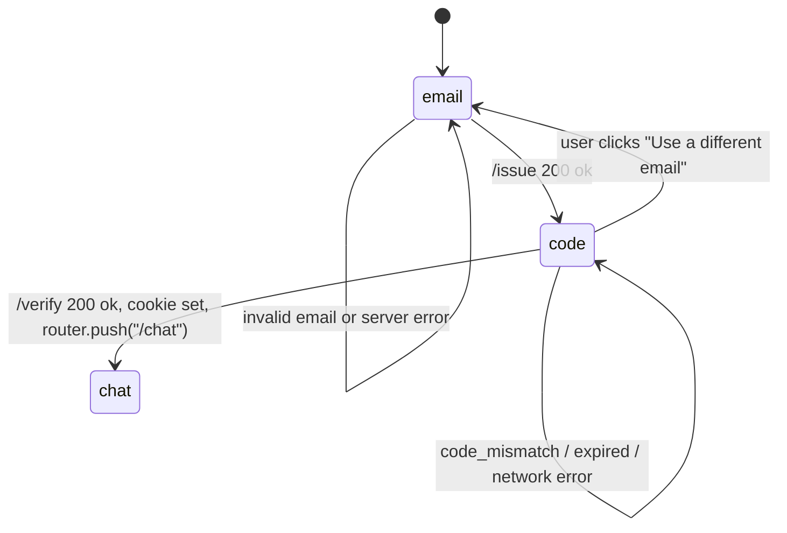

# Authentication Routes

> Last verified against code: 2026-10-08 (OTP verify brute-force hardening: per-code attempt budget, verify rate limits, trusted client IP).

## TL;DR

This is the login system — no passwords, just email codes. A student types their NYU email, the server sends a six-digit code to their inbox, the student types the code back in, and they're in. There's no separate signup step: the first successful login also creates the student's account in the database. After verification, the server hands the browser an invisible signed token that proves the student is who they say they are for the next 30 days. The student's NetID becomes their permanent identifier, used everywhere in the system to look up their plan, conversations, and preferences. Logging out simply throws the token away.


---

## 1. Overview

NYU Path uses passwordless email one-time-password (OTP) authentication. There is no signup flow — every successful OTP verification upserts a row into `students`, so login and signup are the same event. After verification the server hands the client a signed JWT, but only via an HttpOnly cookie; the token is never echoed in the JSON response body.

Three routes make up the surface area:

- `POST /api/auth/otp/issue` — student types their email, server emails a 6-digit code.
- `POST /api/auth/otp/verify` — student types the code, server sets the session cookie and returns the canonical studentId.
- `POST /api/auth/logout` — server clears the cookie.

The session is keyed on a JWT whose `sub` claim is the NYU NetID prefix (the local-part of the email before `@nyu.edu`). That same string is the studentId used as a foreign key across `students`, `forward_schedules`, `schedule_preferences`, `chat_messages`, `audit_log`, and `session_summaries`.

The `/login` page (`apps/web/app/login/page.tsx`) is the only place where humans interact with these routes directly. It is a two-step single-page UI: enter email, then enter the emailed code.

```mermaid
flowchart LR
    A[User on /login] -->|email| B[POST /api/auth/otp/issue]
    B -->|emails code via Resend| C[User mailbox]
    C -->|user types code| D[POST /api/auth/otp/verify]
    D -->|Set-Cookie: nyupath_session| E[router.push /chat]
    E -->|on chat page| F[v2 chat route reads cookie]
    G[Sidebar Sign out] -->|POST| H[/api/auth/logout]
    H -->|clears cookie| A
```

## 2. POST /api/auth/otp/issue

**File:** `apps/web/app/api/auth/otp/issue/route.ts:25`
**Runtime:** Node.js (`runtime = "nodejs"`).

### Request shape

JSON body with one field:
- `email` — required string.

If the body is not valid JSON, returns 400 with `"Body must be JSON with an email field."`. If `email` is missing or non-string, returns 400 with `"email is required."`.

### Rate limit (per IP)

Before any work, the route applies a per-IP daily quota of 5 issuances via `consumeRequest` (`apps/web/app/api/auth/otp/issue/route.ts:23,26`). The bucket key is `otp-ip:<ip>`, where the IP comes from the shared `clientIp` helper (`apps/web/lib/clientIp.ts:30`) — see [Client IP (trust model)](#client-ip-trust-model) below. On block, returns HTTP 429 with body `{ ok: false, error: "Too many login attempts from this IP. Try again after <resetAt>." }` and a `Retry-After` header in seconds.

This limiter is entirely in-process (per server instance) and resets on every restart — see [rate-limit-and-middleware.md, Known limitations](./rate-limit-and-middleware.md#4-known-limitations). Treat it as an abuse speed bump, not a hard control. There is no per-email cap on issuance; the brute-force guard that holds across instances is the per-code attempt budget in `verifyOtp` (§3, §6).

### Client IP (trust model)

`clientIp(headers, env)` (`apps/web/lib/clientIp.ts:30-41`) is used by both OTP routes:

1. When `VERCEL` is set (Vercel exposes `VERCEL=1` at runtime), the first entry of `x-vercel-forwarded-for`.
2. Otherwise — or if that header is absent — the first hop of `X-Forwarded-For`, then `X-Real-IP`, then the literal `anonymous` (one shared bucket).

The assumption: **production runs on Vercel.** Vercel sets `x-vercel-forwarded-for` to the client's public IP and overwrites `X-Forwarded-For` / `X-Real-IP` to prevent spoofing ([Vercel request headers](https://vercel.com/docs/headers/request-headers), checked 2026-10-08), so a caller cannot pick its own bucket there. `x-vercel-forwarded-for` is preferred because it survives a proxy placed in front of Vercel. The Vercel header is ignored when `VERCEL` is unset, because off Vercel a client could send it.

Off Vercel (local dev, or a self-host without an overwriting proxy) every one of these headers is client-controlled, so an IP bucket there is only a speed bump. The helper deliberately does **not** fall back to the rightmost `X-Forwarded-For` hop: behind a multi-proxy chain that would put every user in the nearest proxy's bucket and let one caller lock everyone out. The onboard and what-if-audit routes still derive their IP inline from the first `X-Forwarded-For` hop (see [rate-limit-and-middleware.md](./rate-limit-and-middleware.md)).

### Email allowlist

`issueOtp` accepts the email only if it matches `^[a-z0-9._%+-]+@nyu\.edu$` (`apps/web/lib/auth/otp.ts:24`) OR appears in the comma-separated `AUTH_TEST_EMAILS` env var (`apps/web/lib/auth/otp.ts:33-40`). When neither matches, returns 400 with the message about only accepting `@nyu.edu` addresses (`apps/web/app/api/auth/otp/issue/route.ts:45-53`).

### Code generation and persistence

`issueOtp` (`apps/web/lib/auth/otp.ts:83`) does:
1. Generates a 6-digit decimal code using `crypto.randomInt(0, 1_000_000)` zero-padded to 6 characters (`apps/web/lib/auth/otp.ts:91`).
2. Records `issuedAt = now` and `expiresAt = now + 10 minutes` (TTL `OTP_TTL_MS = 10 * 60 * 1000` at `apps/web/lib/auth/otp.ts:25`).
3. Inserts a row into the `email_otps` table with the lowercased email, the sha256 hash of the code, `issuedAt`, and `expiresAt` (`apps/web/lib/auth/otp.ts:94-99`); `attempts` defaults to 0 and `consumedAt` to null. The plaintext code is never written to the DB.

### Email send (Resend)

The send path branches on `RESEND_API_KEY`:
- Missing key → returns `{ ok: false, reason: "send_failed" }`, which the route maps to HTTP 502.
- Key equals literal string `__test__` → skips the network call entirely and returns `{ ok: true, debugCode: code }`. The route then echoes that debug code in the response body so tests can complete end-to-end (`apps/web/lib/auth/otp.ts:101-107`, `apps/web/app/api/auth/otp/issue/route.ts:65-68`).
- Any other value → constructs a `Resend` client, calls `resend.emails.send` with `from = RESEND_FROM ?? "NYU Path <onboarding@resend.dev>"`, `to = email`, subject `"Your NYU Path login code"`, and a plain-text body containing the code (`apps/web/lib/auth/otp.ts:109-116`).

### Response shapes

- Success: HTTP 200 `{ ok: true }`, plus `debugCode` when the test sentinel is active.
- Validation failure: HTTP 400 `{ ok: false, error: <message> }`.
- DB unavailable: HTTP 503.
- Send failure: HTTP 502.
- Rate-limited: HTTP 429 with `Retry-After` header.

Result reasons map to status codes at `apps/web/app/api/auth/otp/issue/route.ts:44-64`.

## 3. POST /api/auth/otp/verify

**File:** `apps/web/app/api/auth/otp/verify/route.ts:37`
**Runtime:** Node.js.

Because the signed `nyupath_session` cookie is the only identity the app trusts, this route is the sole gate to any student's data. It is brute-force guarded twice: in-process rate limits here, and a durable per-code attempt budget inside `verifyOtp` (§6).

### Rate limits (per IP and per email)

Both are checked with `consumeRequest` **before** any code comparison; either one blocking returns HTTP 429 with `Retry-After` (seconds to the next UTC midnight) and `{ ok: false, error: "Too many login attempts from this IP|for this email. Try again after <resetAt>." }` (`apps/web/app/api/auth/otp/verify/route.ts:30-35`).

| Bucket key | Limit | Checked | Why this number |
|---|---|---|---|
| `otp-verify-ip:<clientIp>` | 25 / UTC day | first, before the body is parsed (`route.ts:38-39`) | 5 issued codes/IP/day × 5 attempts per code |
| `otp-verify-email:<trimmed, lower-cased email>` | 10 / UTC day | after body validation (`route.ts:50-52`) | two codes' worth of attempts |

The IP comes from `clientIp` ([trust model](#client-ip-trust-model)). Every verify call counts, successful or not. Trade-off: anyone who knows a student's email can spend that email's 10 daily verifies and lock the student out of logging in until UTC midnight (8 pm New York time during daylight saving); an IP-only limit would avoid that but would let a rotating-IP attacker keep guessing. These buckets are in-process, so they multiply by instance count and reset on restart — the attempt budget below is the control that holds across instances.

### Request shape

JSON body with two fields:
- `email` — required string.
- `code` — required string. Both fields are trimmed before being passed to `verifyOtp`.

### Code validation flow

`verifyOtp` (`apps/web/lib/auth/otp.ts:123`) executes:
1. Re-applies the same `isAllowedEmail` check (NYU domain or AUTH_TEST_EMAILS). Failure returns `reason: "invalid_email"`.
2. Selects the latest unconsumed, unexpired `email_otps` row for the lowercased email — ordered by `issuedAt DESC`, limited to 1 (`apps/web/lib/auth/otp.ts:135-146`). If no row matches, returns `reason: "no_pending_otp"`. This SELECT deliberately does **not** filter on `attempts`: the newest pending code is *the* code, and skipping a burned row would hand the caller a fresh budget against an older, still-live code.
3. **Reserves one attempt** with a single conditional UPDATE: `attempts = attempts + 1 WHERE (email, issuedAt) AND consumedAt IS NULL AND attempts < MAX_VERIFY_ATTEMPTS` (5), `RETURNING attempts` (`apps/web/lib/auth/otp.ts:157-164`). If no row comes back, returns `reason: "too_many_attempts"` (or `no_pending_otp` if a concurrent verify consumed the row first). Reserving *before* comparing is what makes the cap hold under concurrency.
4. Compares the stored sha256 hash against `sha256(providedCode)` using `crypto.timingSafeEqual` (`apps/web/lib/auth/otp.ts:167-171`) — constant-time. If lengths or bytes differ, returns `reason: "code_mismatch"` (the attempt stays spent).
5. Marks the row consumed with a conditional UPDATE: `consumedAt = now WHERE (email, issuedAt) AND consumedAt IS NULL`, `RETURNING` (`apps/web/lib/auth/otp.ts:175-180`). If no row comes back, a concurrent correct submission won the row and this one returns `reason: "already_consumed"` — so two simultaneous correct submissions mint only one session.
6. Derives the studentId by lowercasing the email and taking the prefix before `@` (`apps/web/lib/auth/otp.ts:77-81`). Upserts a `students` row with `(studentId, email)` ON CONFLICT updates `email` and `updatedAt` (`apps/web/lib/auth/otp.ts:182-189`). This is what makes login double as signup.
7. Signs an HS256 JWT with `sub = studentId`, custom claim `email = lowerEmail`, `iat = now`, `exp = +30d`, using `SECRET_KEY` from env (`apps/web/lib/auth/otp.ts:191-198`). Missing `SECRET_KEY` returns `reason: "db_unavailable"`.

### Session creation and cookie set

On success, the route builds `NextResponse.json({ ok: true, studentId })` and calls `setSessionCookie(res, token)` (`apps/web/app/api/auth/otp/verify/route.ts:73-75`). The JWT itself is never put in the response body.

### Failure messages and status mapping

All failure modes are funneled into a small set of human-readable messages so the client UI stays consistent (`apps/web/app/api/auth/otp/verify/route.ts:55-72`). The `/login` page shows whatever `error` comes back, so no client change is needed for new messages.

| `reason`           | Status | Message                                                              |
|--------------------|--------|----------------------------------------------------------------------|
| (IP rate limit)    | 429    | "Too many login attempts from this IP. Try again after <resetAt>." + `Retry-After` |
| (email rate limit) | 429    | "Too many login attempts for this email. Try again after <resetAt>." + `Retry-After` |
| `expired`          | 401    | "That code has expired. Request a new one."                           |
| `code_mismatch`    | 401    | "That code doesn't match. Double-check the email and try again."      |
| `too_many_attempts`| 401    | "Too many incorrect codes. Request a new code."                       |
| `no_pending_otp`   | 401    | "No active code for that email. Request a new one."                   |
| `invalid_email`    | 400    | "That email isn't allowed."                                           |
| `db_unavailable`   | 503    | "Auth backend is unavailable. Try again in a moment."                 |
| (anything else, incl. `already_consumed`) | 401 | "Couldn't verify the code. Try again."                |

Note: the `expired` mapping appears in the status switch but `verifyOtp`'s current SELECT filter (`gt(emailOtps.expiresAt, now)`) means an expired code falls into the `no_pending_otp` branch in practice — both render as 401 to the client.

## 4. POST /api/auth/logout

**File:** `apps/web/app/api/auth/logout/route.ts:15`
**Runtime:** Node.js.

The handler takes no arguments. It returns `{ ok: true }` and calls `clearSessionCookie(res)` (`apps/web/app/api/auth/logout/route.ts:16-19`). There is no server-side token blacklist: the JWT itself remains cryptographically valid until its 30-day expiry. Authentication state is bound entirely to the client holding the cookie — wipe the cookie, the client loses access.

## 5. Session cookie shape

**File:** `apps/web/lib/auth/session.ts`

The cookie is named `nyupath_session` (`apps/web/lib/auth/session.ts:23`). Its value is a JWT.

### JWT contents

- Algorithm: HS256 (HMAC-SHA256, symmetric, single shared secret).
- Secret: `process.env.SECRET_KEY`. If missing at sign time, OTP verify returns `db_unavailable`. If missing at verify time, the cookie is treated as invalid.
- Claims:
  - `sub` — studentId (NetID prefix). Used as the canonical key everywhere downstream.
  - `email` — lowercased email.
  - `iat` — set by `setIssuedAt()`.
  - `exp` — 30 days after issuance (`setExpirationTime("30d")` at `apps/web/lib/auth/otp.ts:166`).

The token is NOT encrypted, only signed — anyone with the cookie can decode the email and studentId, but they cannot forge new tokens without `SECRET_KEY`.

### Cookie attributes

Set in `setSessionCookie` (`apps/web/lib/auth/session.ts:35-45`):

| Attribute   | Value                                                            |
|-------------|------------------------------------------------------------------|
| `httpOnly`  | `true` — blocks JavaScript reads in the browser.                  |
| `sameSite`  | `lax` — blocks cross-site POSTs but lets navigation links work.   |
| `secure`    | `true` in production, `false` otherwise (for localhost dev).      |
| `path`      | `/` — visible to all routes under the domain.                     |
| `maxAge`    | `30 * 24 * 60 * 60` seconds (30 days) — matches the JWT `exp`.    |

`clearSessionCookie` (`apps/web/lib/auth/session.ts:48-58`) writes a same-named cookie with empty value and `maxAge: 0`, which the browser interprets as immediate deletion.

### Reading the cookie

Two helpers handle reads, depending on context:

- `readSessionFromRequest(req)` (`apps/web/lib/auth/session.ts:81-100`) — for Route Handlers receiving a `NextRequest`. Prefers `req.cookies.get(SESSION_COOKIE)`; if the request mock doesn't have that API (tests), falls back to parsing the `cookie` header by hand.
- `readSessionFromCookies()` (`apps/web/lib/auth/session.ts:104-109`) — for Server Components using `next/headers`.

Both call `verifySessionToken(token)` (`apps/web/lib/auth/session.ts:61-76`) which:
1. Returns `null` if `SECRET_KEY` is unset.
2. Calls `jose.jwtVerify` with `algorithms: ["HS256"]`.
3. Returns `null` if `sub` or `email` claims are not strings.
4. Catches any throw (expired, bad signature, malformed) and returns `null`.

A `null` from either helper means "no authenticated session" — the calling route returns 401.

## 6. OTP utility internals

**File:** `apps/web/lib/auth/otp.ts`

### Code generation

- 6-digit numeric, generated with `crypto.randomInt(0, 1_000_000)` (`apps/web/lib/auth/otp.ts:91`) — uses the OS CSPRNG, so codes are cryptographically unpredictable, not pseudo-random.
- Zero-padded to width 6 so leading-zero codes (e.g. `004217`) render correctly in the email and survive transit as strings.

### TTL

- `OTP_TTL_MS = 10 * 60 * 1000` (`apps/web/lib/auth/otp.ts:25`) — 10 minutes from `issuedAt` to `expiresAt`.
- Stored as an absolute timestamp on the row, not a relative TTL — clock drift on the server is the only window for off-by-N-seconds edge cases.

### Single-use guarantee

Single-use is enforced at the DB layer by the `consumedAt` column:
- On verify, the SELECT filter is `consumedAt IS NULL AND expiresAt > now`. A consumed row is invisible.
- The marking UPDATE sets `consumedAt = now` keyed on `(email, issuedAt)` **and** `consumedAt IS NULL`, and checks the returned row, so the row is consumed at most once even when two correct submissions race. The `issuedAt` discriminator means re-issuing OTPs to the same email produces a new row each time; an earlier code can still be selected if it was the most recent unconsumed one.

Multiple `/issue` calls for the same email just create more rows (only the per-IP issue limit applies). The verify path picks the latest (`orderBy(desc(emailOtps.issuedAt)).limit(1)`).

### Attempt budget

- `MAX_VERIFY_ATTEMPTS = 5` (`apps/web/lib/auth/otp.ts:27`), stored per row in `email_otps.attempts` (`integer NOT NULL DEFAULT 0`, migration `apps/web/drizzle/0004_otp_verify_attempts.sql`).
- Every verify — right or wrong — reserves one attempt with an atomic `UPDATE … WHERE attempts < 5 … RETURNING` before the code is compared. After 5 attempts the row is dead: even the correct code returns `too_many_attempts`, and the student must request a new code. Postgres re-checks the WHERE after taking the row lock, so concurrent guesses cannot exceed the budget (verified against a local Postgres 17: 20 concurrent reserves → exactly 5 succeed).
- Because the select ignores `attempts`, burning the newest code does not re-open an older pending one.
- This is the control that holds across serverless instances and restarts. Worst case per email: each issued code buys 5 guesses (5 / 10^6 chance), and issuance is bounded by the per-IP issue limit plus the Resend sending quota.
- Deploy order: apply migration `0004` **before** deploying this code — the verify query references the `attempts` column. The migration is additive (existing rows get 0), so the old code keeps working against the migrated table.

### Hashing

- `sha256` (no salt, no pepper) of the plain code (`apps/web/lib/auth/otp.ts:73-75`).
- A salt would block precomputed-rainbow attacks on the hash, but with a 6-digit code space the entire universe is 10^6 entries — anyone who exfiltrates the table can brute-force any single hash in milliseconds. The hash mostly prevents casual disclosure to an operator scanning logs/the DB.
- Comparison uses `timingSafeEqual` on the hex-decoded buffers (`apps/web/lib/auth/otp.ts:167-171`) — constant-time, no early-exit on first-byte mismatch.

## 7. Login page UI flow

**File:** `apps/web/app/login/page.tsx`

A client component (`"use client"` at `apps/web/app/login/page.tsx:15`). State machine has two visible steps:

- `"email"` — form with a single email input. Submit calls `POST /api/auth/otp/issue` with `{ email }`. On success (`res.ok && j.ok`), transitions to the `code` step and displays "We sent a 6-digit code to <email>. It expires in 10 minutes." On failure, shows the server's `error` field (or a fallback message). On a thrown fetch (network), shows "Network error. Check your connection and try again."
- `"code"` — form with a 6-digit numeric input. Submit calls `POST /api/auth/otp/verify` with `{ email, code }`. On success, `router.push("/chat")`. On failure, surfaces the server's error string.

The code input is constrained at the client side: `pattern="\d{6}"`, and the `onChange` strips non-digits and slices to 6 characters (`apps/web/app/login/page.tsx:122`). The submit button is disabled until exactly 6 digits are entered.

A "Use a different email" link lets the user return to the email step (clears the code field and any error/info messages).

The page links to `/PRIVACY.md` at the bottom (`apps/web/app/login/page.tsx:147`), described as "ephemeral DPR processing, no cross-session memory in cohort A."



Note: this `/login` page is the documented entry point. There is a separate Next.js `middleware.ts` in `apps/web/`, but it does NOT gate the `/login`, `/chat`, or `/api/auth/*` routes. Its `matcher` is `["/admin/:path*"]` only (`apps/web/middleware.ts:24`), meaning the only thing that file does is HTTP Basic-Auth gate the `/admin` observability dashboard. Session auth is enforced two ways: route handlers (`/api/session/*`, `/api/onboard/refresh-dpr`) call `readSessionFromRequest`, while the `/chat` page is gated by a server-component layout (`apps/web/app/chat/layout.tsx`) that calls `readSessionFromCookies()` and `redirect("/login")` for any request without a valid cookie — see [§8](#8-chat-route-gating). There is no global session middleware.

## 8. /chat route gating

**File:** `apps/web/app/chat/layout.tsx`

The `/chat` surface is protected by a Server Component layout, not by `middleware.ts`. `ChatLayout` (`apps/web/app/chat/layout.tsx:18-22`) awaits `readSessionFromCookies()` and, if the result is `null`, calls `redirect("/login")`. Because this runs on the server before any client JS, a logged-out visitor never sees the chat shell — they are bounced to `/login` during the server render.

The layout's header comment explains why a layout was chosen over middleware: Next.js middleware runs in the Edge runtime, which cannot import `node:crypto` (used by `jose` under the hood for HS256 verification). The layout runs in the same Node runtime as the chat route, keeping the HS256 verify path in one place. The `/admin/*` Basic-Auth middleware (`apps/web/middleware.ts`) sidesteps this by pinning itself to the Node runtime via `config.runtime = "nodejs"`.
