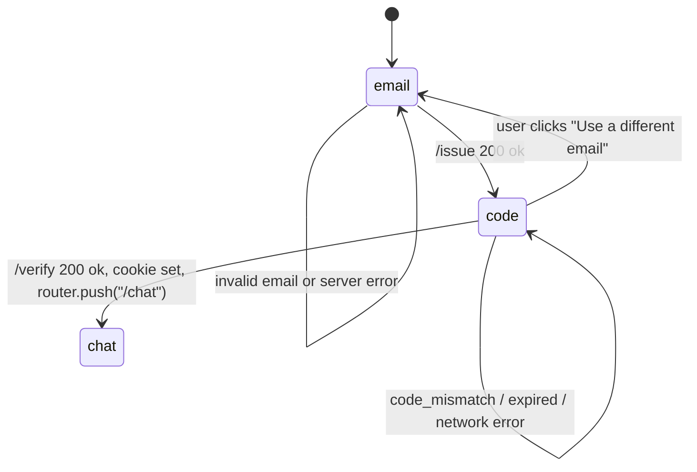

# Authentication Routes

> Last verified against code: 2026-10-08 (PR #58 review fixes: cross-site guard, deletion revokes the session, `test:` subjects).

## TL;DR

This is the login system — no passwords, just email codes. A student types their NYU email, the server sends a six-digit code to their inbox, the student types the code back in, and they're in. There's no separate signup step: the first successful login also creates the student's account in the database. After verification, the server hands the browser an invisible signed token that proves the student is who they say they are for the next 30 days. The student's NetID becomes their permanent identifier, used everywhere in the system to look up their plan, conversations, and preferences. Logging out simply throws the token away; deleting the account also revokes every token issued until then. A request that comes from another website is refused outright, so no other site can sign a student in as someone else or act on their account.


---

## 1. Overview

NYU Path uses passwordless email one-time-password (OTP) authentication. There is no signup flow — every successful OTP verification upserts a row into `students`, so login and signup are the same event. After verification the server hands the client a signed JWT, but only via an HttpOnly cookie; the token is never echoed in the JSON response body.

Three routes make up the surface area:

- `POST /api/auth/otp/issue` — student types their email, server emails a 6-digit code.
- `POST /api/auth/otp/verify` — student types the code, server sets the session cookie and returns the canonical studentId.
- `POST /api/auth/logout` — server clears the cookie.

The session is keyed on a JWT whose `sub` claim is the studentId: the NYU NetID prefix (the local-part before `@nyu.edu`) for an `@nyu.edu` address, or `test:<full lower-cased email>` for an operator-allowlisted address (`AUTH_TEST_EMAILS`) — see §3 step 5. That same string is the studentId used as a foreign key across `students`, `forward_schedules`, `schedule_preferences`, `chat_messages`, `audit_log`, and `session_summaries`.

All three routes refuse a cross-site request before doing anything (§9), and the two OTP routes also refuse a body that declares a non-JSON `Content-Type`.

The `/login` page (`apps/web/app/login/page.tsx`) is the only place where humans interact with these routes directly. It is a two-step single-page UI: enter email, then enter the emailed code.

```mermaid
flowchart LR
    A[User on /login] -->|email| B[POST /api/auth/otp/issue]
    B -->|emails code via Resend| C[User mailbox]
    C -->|user types code| D[POST /api/auth/otp/verify]
    D -->|Set-Cookie: nyupath_session| E[router.push /chat]
    E -->|on chat page| F[v2 chat route reads cookie]
    G[Sidebar Sign out] -->|POST| H[/api/auth/logout]
    H -->|clears cookie| A
```

## 2. POST /api/auth/otp/issue

**File:** `apps/web/app/api/auth/otp/issue/route.ts:32`
**Runtime:** Node.js (`runtime = "nodejs"`).

### Request shape

JSON body with one field:
- `email` — required string.

First, `guardJsonMutation(req)` (§9) refuses a cross-site request (403) or a declared non-JSON body (415) — before the per-IP quota below is charged, so a cross-site page can't burn a visitor's login quota.

If the body is not valid JSON, returns 400 with `"Body must be JSON with an email field."`. If `email` is missing or non-string, returns 400 with `"email is required."`.

### Rate limit (per IP)

After the cross-site guard, the route applies a per-IP daily quota of 5 issuances via `consumeRequest` (`apps/web/app/api/auth/otp/issue/route.ts:21,32`). The bucket key is `otp-ip:<ip>`, where the IP is taken from the first hop of `X-Forwarded-For`, falling back to `X-Real-IP`, falling back to the literal string `anonymous` (`apps/web/app/api/auth/otp/issue/route.ts:23-29`). On block, returns HTTP 429 with body `{ ok: false, error: "Too many login attempts from this IP. Try again after <resetAt>." }` and a `Retry-After` header in seconds.

This limiter is entirely in-process and resets on every server restart, and the IP key is read from the spoofable `X-Forwarded-For` header — see [rate-limit-and-middleware.md, Known limitations](./rate-limit-and-middleware.md#4-known-limitations). Treat it as an abuse speed bump, not a hard control. There is no per-email cap.

### Email allowlist

`issueOtp` accepts the email only if it matches `^[a-z0-9._%+-]+@nyu\.edu$` (`apps/web/lib/auth/otp.ts:22`) OR appears in the comma-separated `AUTH_TEST_EMAILS` env var (`apps/web/lib/auth/otp.ts:29-36`). When neither matches, returns 400 with the message about only accepting `@nyu.edu` addresses (`apps/web/app/api/auth/otp/issue/route.ts:51-58`).

### Code generation and persistence

`issueOtp` (`apps/web/lib/auth/otp.ts:72`) does:
1. Generates a 6-digit decimal code using `crypto.randomInt(0, 1_000_000)` zero-padded to 6 characters (`apps/web/lib/auth/otp.ts:80`).
2. Records `issuedAt = now` and `expiresAt = now + 10 minutes` (TTL `OTP_TTL_MS = 10 * 60 * 1000` at `apps/web/lib/auth/otp.ts:23`).
3. Inserts a row into the `email_otps` table with the lowercased email, the sha256 hash of the code, `issuedAt`, and `expiresAt` (`apps/web/lib/auth/otp.ts:83-88`). The plaintext code is never written to the DB.

### Email send (Resend)

The send path branches on `RESEND_API_KEY`:
- Missing key → returns `{ ok: false, reason: "send_failed" }`, which the route maps to HTTP 502.
- Key equals literal string `__test__` → skips the network call entirely and returns `{ ok: true, debugCode: code }`. The route then echoes that debug code in the response body so tests can complete end-to-end (`apps/web/lib/auth/otp.ts:90-96`, `apps/web/app/api/auth/otp/issue/route.ts:71-74`).
- Any other value → constructs a `Resend` client, calls `resend.emails.send` with `from = RESEND_FROM ?? "NYU Path <onboarding@resend.dev>"`, `to = email`, subject `"Your NYU Path login code"`, and a plain-text body containing the code (`apps/web/lib/auth/otp.ts:98-105`).

### Response shapes

- Success: HTTP 200 `{ ok: true }`, plus `debugCode` when the test sentinel is active.
- Validation failure: HTTP 400 `{ ok: false, error: <message> }`.
- DB unavailable: HTTP 503.
- Send failure: HTTP 502.
- Rate-limited: HTTP 429 with `Retry-After` header.

Result reasons map to status codes at `apps/web/app/api/auth/otp/issue/route.ts:50-69`.

## 3. POST /api/auth/otp/verify

**File:** `apps/web/app/api/auth/otp/verify/route.ts:17`
**Runtime:** Node.js.

### Request shape

JSON body with two fields:
- `email` — required string.
- `code` — required string. Both fields are trimmed before being passed to `verifyOtp`.

### Login-CSRF guard

The route calls `guardJsonMutation(req)` (§9) before parsing anything. Without it, a cross-site `<form enctype="text/plain">` POST of an attacker's email + fresh code (a body that still parses as JSON) would sign the victim's browser in as the attacker, and the victim's DPR upload would then land under the attacker's studentId. A refused request never reaches `verifyOtp` and never gets a `Set-Cookie`.

### Code validation flow

`verifyOtp` (`apps/web/lib/auth/otp.ts:112`) executes:
1. Re-applies the same `isAllowedEmail` check (NYU domain or AUTH_TEST_EMAILS). Failure returns `reason: "invalid_email"`.
2. Selects the latest unconsumed, unexpired `email_otps` row for the lowercased email — ordered by `issuedAt DESC`, limited to 1 (`apps/web/lib/auth/otp.ts:124-135`). If no row matches, returns `reason: "no_pending_otp"`.
3. Compares the stored sha256 hash against `sha256(providedCode)` using `crypto.timingSafeEqual` (`apps/web/lib/auth/otp.ts:140-144`) — constant-time. If lengths or bytes differ, returns `reason: "code_mismatch"`.
4. Marks the row consumed by setting `consumedAt = now` on the matched (email, issuedAt) tuple (`apps/web/lib/auth/otp.ts:146-149`). This single-use marking guards against double redemption — subsequent verifies for that code will fail the "unconsumed" filter in step 2.
5. Derives the studentId with `emailToStudentId` (`apps/web/lib/auth/otp.ts:74`): an `@nyu.edu` address maps to its NetID prefix; any other allowed address maps to `test:<full lower-cased email>`. The bare local-part is never used for a non-NYU address — it let `abc123@gmail.com` (if allowlisted) sign in as the NYU student `abc123` and read/write that student's rows. In one transaction (`apps/web/lib/auth/otp.ts:160-177`) it first releases this email from any OTHER `students` row (`email = NULL` where `email` matches and `student_id` differs — `students.email` is UNIQUE, so a row keyed on an older subject would otherwise fail every login), then upserts the `students` row with `(studentId, email)` ON CONFLICT updating `email` and `updatedAt`. This is what makes login double as signup.
6. Signs an HS256 JWT with `sub = studentId`, custom claim `email = lowerEmail`, `iat = now`, `exp = +30d`, using `SECRET_KEY` from env (`apps/web/lib/auth/otp.ts:179-186`). Missing `SECRET_KEY` returns `reason: "db_unavailable"`.

**Operator note — existing allowlisted accounts.** A non-NYU allowlisted account that signed in before the `test:` namespace has its rows under the bare local-part. After this change it signs in as `test:<email>`, a fresh account (re-onboard by uploading the DPR); the old rows are no longer reachable by login. Do not bulk-delete "non-NYU-email" rows to clean up: under the old scheme an allowlisted login could overwrite a real NYU student's `students.email` with the allowlisted address, so such a row may belong to a real student. Classify each row before deleting anything.

### Session creation and cookie set

On success, the route builds `NextResponse.json({ ok: true, studentId })` and calls `setSessionCookie(res, token)` (`apps/web/app/api/auth/otp/verify/route.ts:49-50`). The JWT itself is never put in the response body.

### Failure messages and status mapping

All failure modes are funneled into a small set of human-readable messages so the client UI stays consistent (`apps/web/app/api/auth/otp/verify/route.ts:30-41`):

| `reason`           | Status | Message                                                              |
|--------------------|--------|----------------------------------------------------------------------|
| `expired`          | 401    | "That code has expired. Request a new one."                           |
| `code_mismatch`    | 401    | "That code doesn't match. Double-check the email and try again."      |
| `no_pending_otp`   | 401    | "No active code for that email. Request a new one."                   |
| `invalid_email`    | 400    | "That email isn't allowed."                                           |
| `db_unavailable`   | 503    | "Auth backend is unavailable. Try again in a moment."                 |
| (anything else)    | 401    | "Couldn't verify the code. Try again."                                |

Note: the `expired` mapping appears in the status switch but `verifyOtp`'s current SELECT filter (`gt(emailOtps.expiresAt, now)`) means an expired code falls into the `no_pending_otp` branch in practice — both render as 401 to the client.

## 4. POST /api/auth/logout

**File:** `apps/web/app/api/auth/logout/route.ts:16`
**Runtime:** Node.js.

The handler first calls `rejectCrossSiteRequest(req)` (§9) — a cross-site page can't sign the student out — then returns `{ ok: true }` and calls `clearSessionCookie(res)`. Logout does not revoke the token: the JWT remains cryptographically valid until its 30-day expiry, and authentication state is bound to the client holding the cookie — wipe the cookie, the client loses access. Only self-serve account deletion revokes tokens server-side (§10).

## 5. Session cookie shape

**File:** `apps/web/lib/auth/session.ts`

The cookie is named `nyupath_session` (`apps/web/lib/auth/session.ts:23`). Its value is a JWT.

### JWT contents

- Algorithm: HS256 (HMAC-SHA256, symmetric, single shared secret).
- Secret: `process.env.SECRET_KEY`. If missing at sign time, OTP verify returns `db_unavailable`. If missing at verify time, the cookie is treated as invalid.
- Claims:
  - `sub` — studentId (NetID prefix, or `test:<email>` for an allowlisted non-NYU login). Used as the canonical key everywhere downstream.
  - `email` — lowercased email.
  - `iat` — set by `setIssuedAt()`; compared against a deletion revocation (§10).
  - `exp` — 30 days after issuance (`setExpirationTime("30d")` at `apps/web/lib/auth/otp.ts:166`).

The token is NOT encrypted, only signed — anyone with the cookie can decode the email and studentId, but they cannot forge new tokens without `SECRET_KEY`.

### Cookie attributes

Set in `setSessionCookie` (`apps/web/lib/auth/session.ts:45`):

| Attribute   | Value                                                            |
|-------------|------------------------------------------------------------------|
| `httpOnly`  | `true` — blocks JavaScript reads in the browser.                  |
| `sameSite`  | `lax` — a cross-site POST arrives without it, but navigation links work. Not enough alone — login CSRF needs no cookie, and a same-site sibling subdomain does get Lax cookies — so state-changing routes also run the §9 guard. |
| `secure`    | `true` in production, `false` otherwise (for localhost dev).      |
| `path`      | `/` — visible to all routes under the domain.                     |
| `maxAge`    | `30 * 24 * 60 * 60` seconds (30 days) — matches the JWT `exp`.    |

`clearSessionCookie` (`apps/web/lib/auth/session.ts:58`) writes a same-named cookie with empty value and `maxAge: 0`, which the browser interprets as immediate deletion.

### Reading the cookie

Two helpers handle reads, depending on context:

- `readSessionFromRequest(req)` (`apps/web/lib/auth/session.ts:109`) — for Route Handlers receiving a `NextRequest`. Prefers `req.cookies.get(SESSION_COOKIE)`; if the request mock doesn't have that API (tests), falls back to parsing the `cookie` header by hand.
- `readSessionFromCookies()` (`apps/web/lib/auth/session.ts:132`) — for Server Components using `next/headers`.

Both call `verifySessionToken(token)` (`apps/web/lib/auth/session.ts:72`) which:
1. Returns `null` if `SECRET_KEY` is unset.
2. Calls `jose.jwtVerify` with `algorithms: ["HS256"]`.
3. Returns `null` if `sub` or `email` claims are not strings.
4. Catches any throw (expired, bad signature, malformed) and returns `null`.
5. Returns `null` if the student deleted their account at or after the token's `iat` (`isSessionRevoked`, §10). If that lookup itself fails, it logs `[auth] session revocation check failed` and returns `null` — fail closed.

The returned `SessionClaims` carry `sub`, `email`, and `iat` (seconds).

A `null` from either helper means "no authenticated session" — the calling route returns 401.

## 6. OTP utility internals

**File:** `apps/web/lib/auth/otp.ts`

### Code generation

- 6-digit numeric, generated with `crypto.randomInt(0, 1_000_000)` (`apps/web/lib/auth/otp.ts:80`) — uses the OS CSPRNG, so codes are cryptographically unpredictable, not pseudo-random.
- Zero-padded to width 6 so leading-zero codes (e.g. `004217`) render correctly in the email and survive transit as strings.

### TTL

- `OTP_TTL_MS = 10 * 60 * 1000` (`apps/web/lib/auth/otp.ts:23`) — 10 minutes from `issuedAt` to `expiresAt`.
- Stored as an absolute timestamp on the row, not a relative TTL — clock drift on the server is the only window for off-by-N-seconds edge cases.

### Single-use guarantee

Single-use is enforced at the DB layer by the `consumedAt` column:
- On verify, the SELECT filter is `consumedAt IS NULL AND expiresAt > now`. A consumed row is invisible.
- The marking UPDATE sets `consumedAt = now` keyed on `(email, issuedAt)`. The `issuedAt` discriminator means re-issuing OTPs to the same email produces a new row each time; an earlier code can still be selected if it was the most recent unconsumed one, but each row is consumed at most once.

There is no per-email rate limit beyond what the `/issue` route's per-IP guard enforces; multiple `/issue` calls for the same email just create more rows. The verify path picks the latest (`orderBy(desc(emailOtps.issuedAt)).limit(1)`).

### Hashing

- `sha256` (no salt, no pepper) of the plain code (`apps/web/lib/auth/otp.ts:62-64`).
- A salt would block precomputed-rainbow attacks on the hash, but with a 6-digit code space the entire universe is 10^6 entries — anyone who exfiltrates the table can brute-force any single hash in milliseconds. The hash mostly prevents casual disclosure to an operator scanning logs/the DB.
- Comparison uses `timingSafeEqual` on the hex-decoded buffers (`apps/web/lib/auth/otp.ts:140-144`) — constant-time, no early-exit on first-byte mismatch.

## 7. Login page UI flow

**File:** `apps/web/app/login/page.tsx`

A client component (`"use client"` at `apps/web/app/login/page.tsx:15`). State machine has two visible steps:

- `"email"` — form with a single email input. Submit calls `POST /api/auth/otp/issue` with `{ email }`. On success (`res.ok && j.ok`), transitions to the `code` step and displays "We sent a 6-digit code to <email>. It expires in 10 minutes." On failure, shows the server's `error` field (or a fallback message). On a thrown fetch (network), shows "Network error. Check your connection and try again."
- `"code"` — form with a 6-digit numeric input. Submit calls `POST /api/auth/otp/verify` with `{ email, code }`. On success, `router.push("/chat")`. On failure, surfaces the server's error string.

The code input is constrained at the client side: `pattern="\d{6}"`, and the `onChange` strips non-digits and slices to 6 characters (`apps/web/app/login/page.tsx:122`). The submit button is disabled until exactly 6 digits are entered.

A "Use a different email" link lets the user return to the email step (clears the code field and any error/info messages).

The page links to `/PRIVACY.md` at the bottom (`apps/web/app/login/page.tsx:147`), described as "ephemeral DPR processing, no cross-session memory in cohort A."



Note: this `/login` page is the documented entry point. There is a separate Next.js `middleware.ts` in `apps/web/`, but it does NOT gate the `/login`, `/chat`, or `/api/auth/*` routes. Its `matcher` is `["/admin/:path*"]` only (`apps/web/middleware.ts:24`), meaning the only thing that file does is HTTP Basic-Auth gate the `/admin` observability dashboard. Session auth is enforced two ways: route handlers (`/api/session/*`, `/api/onboard/refresh-dpr`) call `readSessionFromRequest`, while the `/chat` page is gated by a server-component layout (`apps/web/app/chat/layout.tsx`) that calls `readSessionFromCookies()` and `redirect("/login")` for any request without a valid cookie — see [§8](#8-chat-route-gating). There is no global session middleware.

## 8. /chat route gating

**File:** `apps/web/app/chat/layout.tsx`

The `/chat` surface is protected by a Server Component layout, not by `middleware.ts`. `ChatLayout` (`apps/web/app/chat/layout.tsx:18-22`) awaits `readSessionFromCookies()` and, if the result is `null`, calls `redirect("/login")`. Because this runs on the server before any client JS, a logged-out visitor never sees the chat shell — they are bounced to `/login` during the server render.

The layout's header comment explains why a layout was chosen over middleware: Next.js middleware runs in the Edge runtime, which cannot import `node:crypto` (used by `jose` under the hood for HS256 verification). The layout runs in the same Node runtime as the chat route, keeping the HS256 verify path in one place. The `/admin/*` Basic-Auth middleware (`apps/web/middleware.ts`) sidesteps this by pinning itself to the Node runtime via `config.runtime = "nodejs"`.

## 9. Cross-site request guard

**File:** `apps/web/lib/auth/requestGuards.ts`

Every state-changing `/api` handler (POST/PUT/PATCH/DELETE) calls the guard before it reads the session, parses the body or charges a rate-limit bucket. `apps/web/tests/crossSiteRequestGuard.test.ts` fails if a handler under `app/api` skips it.

- `rejectCrossSiteRequest(req)` (`requestGuards.ts:63`) → 403 `{ ok: false, error: "Cross-site request refused. Use NYU Path directly." }` unless the request is same-origin. It follows Go 1.25's `CrossOriginProtection`:
  1. `Sec-Fetch-Site` present (every current browser): allow only `same-origin` or `none`; refuse `same-site` and `cross-site`.
  2. Otherwise an `Origin` header must name this host (`Host`, or `X-Forwarded-Host` behind a proxy). `Origin: null` never matches.
  3. Neither header: not a browser request (curl, server-side fetch, tests), so it can't be carrying a victim's cookies — allowed.
- `rejectNonJsonBody(req)` (`requestGuards.ts:78`) → 415 `{ ok: false, error: "Content-Type must be application/json." }` when the request declares any other `Content-Type`. `text/plain`, urlencoded and multipart are the only bodies an HTML form (or a no-preflight fetch) can send, so this closes login CSRF even in a browser that sends neither header above. A request that declares no `Content-Type` isn't a form post and passes.
- `guardJsonMutation(req)` (`requestGuards.ts:90`) = cross-site check, then the JSON check.

| Route | Guard |
|---|---|
| `/api/auth/otp/issue`, `/api/auth/otp/verify`, `/api/chat`, `/api/chat/v2`, `/api/plan/explain-polish`, `/api/plan/stage2` | `guardJsonMutation` |
| `/api/plan/{add,drop,move,swap,lock,confirm,whatif}` | `guardJsonMutation`, in the shared `preflight` (`apps/web/lib/planActionRouteHelpers.ts`) |
| `/api/onboard`, `/api/onboard/refresh-dpr`, `/api/whatif-audit` (multipart uploads), `/api/session/delete`, `/api/session/clear`, `/api/auth/logout` (no body) | `rejectCrossSiteRequest` |

`GET /api/session/restore` is a read and is not guarded.

## 10. Session revocation (self-serve delete)

**File:** `apps/web/lib/auth/revocation.ts`

The session JWT is stateless, so wiping a student's rows does not end their sessions by itself: a later request from another open tab, or a chat turn already in flight, would write the account back (every Postgres store write upserts the `students` row). So `/api/session/delete` ([session-and-onboarding-routes.md](./session-and-onboarding-routes.md)) records a revocation and clears the cookie:

- **Tombstone.** `recordSessionRevocation(tx, studentId, at)` (`revocation.ts:64`) upserts `session_revocations(student_id, revoked_at)` inside the delete's wipe transaction (table: [db-and-stores.md](./db-and-stores.md)). The table has no foreign key to `students`, so the tombstone outlives the row it revokes. Without `DATABASE_URL` the tombstones live in a process-wide map on `globalThis` (Next loads route handlers and the `/chat` layout as separate module instances; both must see it).
- **Every later request.** `isSessionRevoked({ sub, iat })` (`revocation.ts:96`) is true when `iat * 1000 <= revoked_at` — a token minted in the same second as the deletion counts as revoked (the safe side). `verifySessionToken` returns `null` for it, so every route answers 401 and `/chat` redirects to `/login`. A token issued after the deletion — the student signs in again — verifies normally.
- **An in-flight chat turn.** The chat route fences its stores for the turn with `fenceStoresForSession(stores, claims)` (`revocation.ts:149`): each write (`persistMutation`, `persistSchedule`, `persistPreferences`, `clearScheduleForStudent`, `appendMessage`, `clearForStudent`, `appendSummary`, `replace`) first re-checks the revocation and throws `SessionRevokedError` if the session is revoked or the check fails. Every call site already treats persistence as no-throw (log and continue), so the turn finishes without writing the account back. Reads pass through.

Residual race: a fenced write that checked the tombstone just before the delete committed can still land a moment after it.
